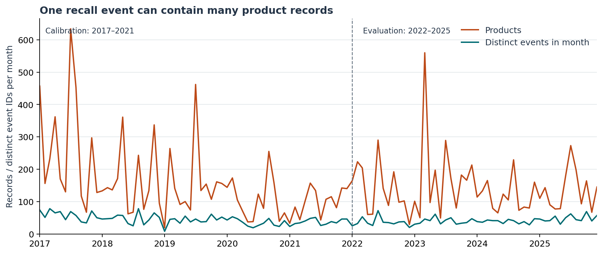

# Product counts and recall-event counts

An internal research-data queue needs a clear counting unit. In the fixed 2022–2025 FDA food-enforcement snapshot, an event-calibrated threshold flags **41 of 48 months** when applied to product counts and **one month** when applied to event counts. Separate product calibration reduces the product policy to one flagged month, but the two policies select different months. These are counting-policy differences, not verified safety false alarms.

Keep a lossless product table and an explicit event view. Match each threshold to the unit of its review task and retain every product link. A recall event can legitimately contain several products; they are not presumed duplicate errors.

Read the [seven-page manuscript](paper/manuscript.pdf), [fixed executable protocol](PROTOCOL.md), [source/rights boundary](DATA_RIGHTS.md) and [primary references](SOURCES.md). This independent, AI-assisted study is not peer reviewed or accepted for formal publication. Separate formal-publication projects, including Azure optimization, remain private.



The complete captured panel contains 16, 324 products, 4, 601 event IDs and 108 months. Calibration uses 2017–2021; evaluation uses 2022–2025 after a committed twelve-dependency freeze. All three quantiles, four panels, both threshold choices and five calibration-year omissions are retained. No model tuning, NLP, human-audited linkage or amendment-history claim.

## Evidence and reproduction

Nine boundary tests; 261, 184 independently compared selected/normalized source fields; 13, 608 development and 10, 685 evaluation values reconstructed using SQL/decimal/rational arithmetic; 196, 440 exact fields/documents and 1, 296 floating values replayed offline; 528 plotted values checked;all seven manuscript pages rendered and inspected. Finite checks do not establish universal correctness or accessibility conformance.

With Python 3.10:

```sh
python -m pip install -r requirements.txt
python -m unittest discover -s tests -v
python src/check_reproduction.py
python src/verify_figures.py
python src/verify_paper.py
python src/verify_public_package.py
```

The public replay reads only the minimized source. Complete originals stay outside Git; retained hashes/certificates document the earlier full comparison. Re-fetching later records is a new snapshot and requires new checks. The source metadata version is 2026-10-21;consistent metadata/count probes do not guarantee a transactional snapshot.

## Limits that affect use

FDA warns against using this endpoint to issue public alerts or track recall lifecycles. This is an illustrative internal data-review policy comparison using a later historical snapshot. Report dates do not reconstruct historical availability, initiation or warning dates. No verified hazard labels, exposure denominator, prospective performance, clinical advice, causal effect, deployment or realized savings are claimed. Event-class memberships can overlap. Product and event review tasks have different purposes; neither counting policy is ground truth.
